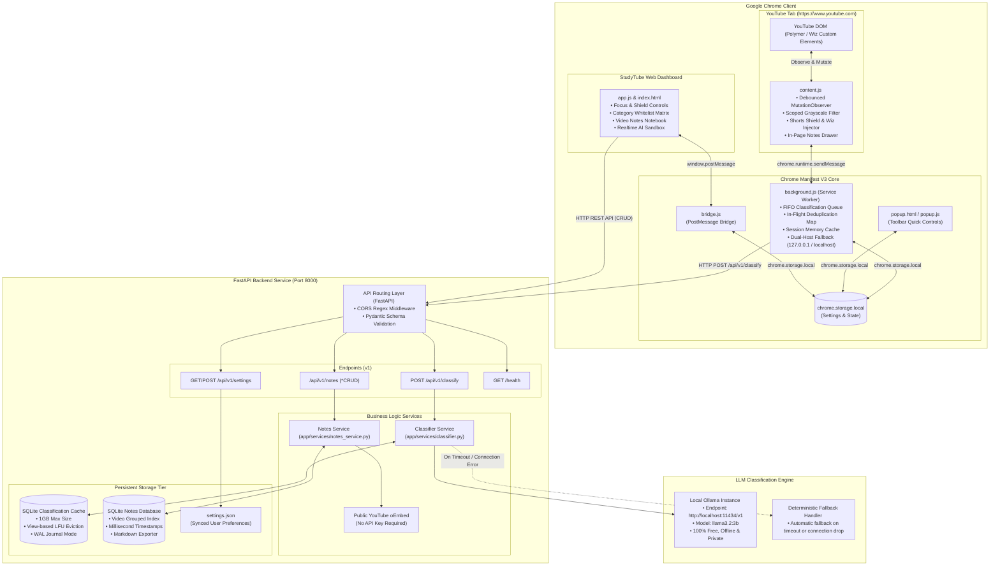
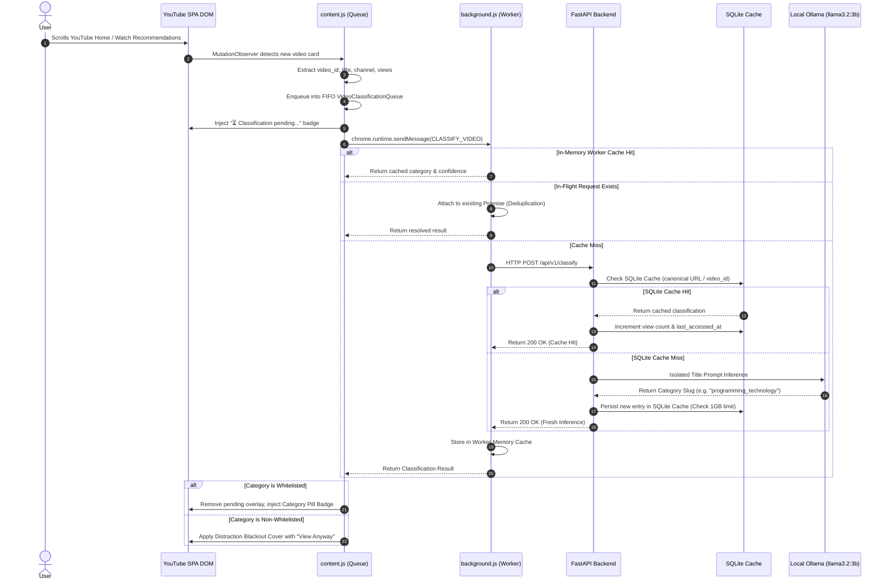
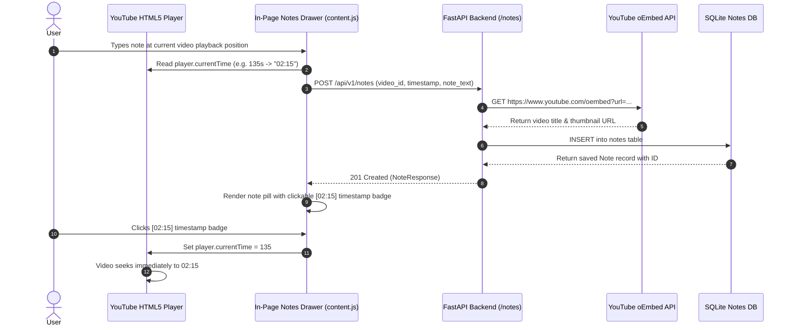
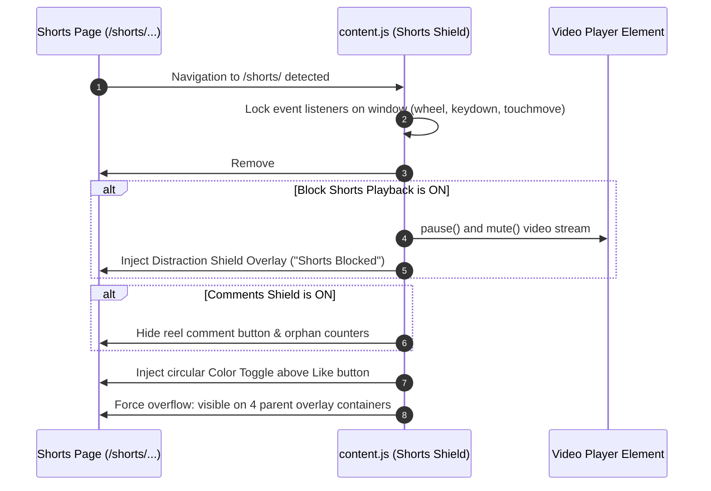
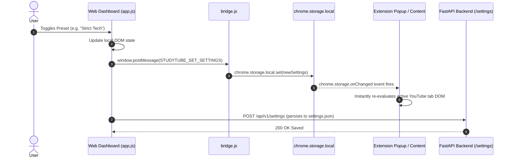

# 🏗️ StudyTube — Technical Architecture & System Design

This document details the concrete technical architecture, implemented module boundaries, runtime sequence flows, data lifecycle, caching mechanisms, and security model of **StudyTube**.

---

## 📑 Table of Contents

- [1. Executive System Overview](#1-executive-system-overview)
- [2. System Architecture Diagram](#2-system-architecture-diagram)
- [3. Subsystem Breakdown](#3-subsystem-breakdown)
  - [3.1 Chrome Extension (Manifest V3)](#31-chrome-extension-manifest-v3)
  - [3.2 FastAPI Backend Microservice](#32-fastapi-backend-microservice)
  - [3.3 AI Classification Tier (Local Ollama)](#33-ai-classification-tier-local-ollama)
  - [3.4 Persistent Storage Tier (SQLite)](#34-persistent-storage-tier-sqlite)
  - [3.5 Reactive Web Dashboard](#35-reactive-web-dashboard)
- [4. Core Workflows & Sequence Diagrams](#4-core-workflows--sequence-diagrams)
  - [4.1 Video Card Discovery & Classification Flow](#41-video-card-discovery--classification-flow)
  - [4.2 Timestamped Video Notes Taking & Metadata Resolution](#42-timestamped-video-notes-taking--metadata-resolution)
  - [4.3 YouTube Shorts Distraction Shielding & Wiz Injection](#43-youtube-shorts-distraction-shielding--wiz-injection)
  - [4.4 Cross-Context Settings Synchronization](#44-cross-context-settings-synchronization)
- [5. Cache Architecture & LFU Eviction Mechanics](#5-cache-architecture--lfu-eviction-mechanics)
- [6. Security & Privacy Model](#6-security--privacy-model)
- [7. Implemented Technology Stack](#7-implemented-technology-stack)

---

## 1. Executive System Overview

StudyTube is an end-to-end focus and productivity system for YouTube. It decouples in-browser user interface interception from backend computation (Large Language Model inference, semantic classification, persistent caching, and note storage).

### Key Architectural Pillars:
1. **Zero-Overhead DOM Interception**: Employs debounced MutationObservers and CSS-first filtering on YouTube's dynamic Single Page Application (Polymer/Wiz custom elements).
2. **Client-Side Anti-Overload Queuing**: Enforces a strict FIFO classification queue in the Chrome extension so rapid scrolling does not swamp the local Ollama LLM.
3. **Multi-Tier Caching Hierarchy**: Three-level cache (Extension In-Memory -> Service Worker Map -> Persistent SQLite 1GB LFU Cache) minimizes redundant LLM inferences to near-zero for repeating videos.
4. **Data Minimization & Privacy-First Prompts**: The local LLM receives strictly isolated video titles and sanitized taxonomy instructions; raw URLs, channel metadata, user tokens, and browsing histories are stripped before inference.
5. **Zero Client Secrets**: All credentials and backend settings are confined strictly to `backend/.env` and are never loaded, transmitted, or accessible to the browser client or extension scripts.

---

## 2. System Architecture Diagram



---

## 3. Subsystem Breakdown

### 3.1 Chrome Extension (Manifest V3)

The Chrome extension acts as the client-side orchestrator. It intercepts YouTube's layout, enforces focus rules, provides the in-page notes drawer, and proxies requests to the backend.

- **`content.js`**:
  - Injected directly into all `*://*.youtube.com/*` frames at `document_idle`.
  - Attaches a debounced `MutationObserver` to `document.documentElement` to detect newly mounted recommendation cards (`ytd-rich-item-renderer`, `ytd-video-renderer`, `ytd-compact-video-renderer`, and `yt-lockup-view-model`).
  - Manages the **FIFO VideoClassificationQueue**: ensures only 1 card is being classified at any instant to avoid overloading the local Ollama LLM.
  - Injects native-looking YouTube UI elements:
    - **Watch Color Toggle**: A pill button inserted dynamically next to YouTube's native Share button.
    - **Shorts Color Toggle**: A 48x48px circular button injected into `<reel-action-bar-view-model>`.
    - **In-Page Notes Drawer**: Collapsible sidebar notes panel embedded in the Watch sidebar.
  - Enforces DOM shields:
    - Shorts infinite scroll interceptor (`wheel`, `touchmove`, `keydown` navigation lock).
    - Shorts playback freeze & distraction screen.
    - Comments section collapsible shield (`ytd-comments`, `ytd-reel-player-overlay-renderer #comments-button`).
    - Live chat iframe removal.

- **`background.js` (Service Worker)**:
  - Event coordinator for background tasks.
  - Maintains `memoryCache` (session Map) and `inFlightRequests` Map to prevent duplicate simultaneous classifications for the same video ID.
  - Handles **Dual-Host Network Resilience**: Automatically checks `http://127.0.0.1:8000` and `http://localhost:8000`.
  - Implements safe fallback: Returns deterministic fallback categories with `is_fallback: true` on offline or timeout events.

- **`bridge.js`**:
  - Injected at `document_start` on dashboard origins and local files.
  - Bridges the web dashboard window (`window.postMessage`) and Chrome storage (`chrome.storage.local`).

- **`popup.html` / `popup.js`**:
  - Lightweight browser toolbar UI for instant toggles, quick whitelist presets (**Study Focus**, **Strict Tech**, **Allow All**, **Block All**), and backend connectivity status.

---

### 3.2 FastAPI Backend Microservice

The backend is built with **FastAPI** (`backend/app/main.py`), utilizing asynchronous event loops for non-blocking I/O.

- **Routing & Endpoints**:
  - `POST /api/v1/classify`: Accepts `video_id`, `title`, `channel_name`, `url`, `views`. Validates inputs with Pydantic and returns category classifications.
  - `GET /api/v1/notes`: Fetches notes, optionally filtered by `video_id`.
  - `POST /api/v1/notes`: Stores a new note with automatic YouTube oEmbed title/thumbnail resolution.
  - `GET /api/v1/notes/videos`: Returns all notes grouped by video for notebook cards.
  - `DELETE /api/v1/notes/{id}` & `DELETE /api/v1/notes/video/{video_id}`: Granular deletion routes.
  - `GET /api/v1/settings` & `POST /api/v1/settings`: Settings read/write synchronization with `backend/app/settings.json`.
  - `GET /health` & `GET /api/v1/health`: Operational health check reporting version, provider, and active model.
- **CORS Architecture**:
  - Uses `CORSMiddleware` with `allow_origin_regex=r"^chrome-extension://.*$"`.
  - Allows unpacked developer extensions to communicate without requiring fixed Chrome Web Store IDs.

---

### 3.3 AI Classification Tier (Local Ollama)

The classification pipeline is powered by a local **Ollama** instance running `llama3.2:3b`:

- **Host Endpoint**: `http://localhost:11434/v1` (OpenAI-compatible REST interface).
- **Active Model**: `llama3.2:3b`.
- **Classification Engine (`backend/app/services/classifier.py`)**:
  - Communicates directly with the local Ollama instance using HTTPX asynchronous calls.
  - Strips video URLs, channel names, and user identifiers, sending only the sanitized video title.
  - Uses few-shot prompt instructions demanding exactly one category slug.
- **Deterministic Fallback Handler**:
  - If Ollama is not started, is busy, or exceeds the timeout threshold (`15.0s`), the system resolves to a default safe category with `is_fallback: true` and `confidence: 0.1`.
  - Fallback responses are strictly excluded from the persistent SQLite cache so videos are properly re-classified once the LLM is available.

#### Taxonomy & Categories:
Videos are classified into one of **12 granular categories**:
`education_academics`, `programming_technology`, `career_business`, `productivity_self_improvement`, `health_fitness`, `documentaries_explainers`, `news_current_affairs`, `hobbies_creative_arts`, `gaming`, `entertainment_comedy`, `music`, `lifestyle_vlogs`.

#### Prompt Isolation & Privacy Shield:
```text
System: You are an expert YouTube video content classifier.
Classify the video into EXACTLY ONE of the allowed categories:
[education_academics, programming_technology, career_business, ...]
Respond ONLY with the exact category slug.

User:
Title: "Introduction to Dynamic Programming - Tutorial"
Category:
```

---

### 3.4 Persistent Storage Tier (SQLite)

The data tier uses two dedicated SQLite databases with WAL (Write-Ahead Logging) enabled for concurrency:

1. **SQLite Classification Cache (`data/classification_cache.db`)**:
   - Stores: `video_id`, `canonical_url`, `category`, `confidence`, `suggested_mode`, `classifier_provider`, `views_count`, `inference_time_ms`, `created_at`, `last_accessed_at`.
   - **Capacity Cap**: Hard-capped at 1GB (`1073741824 bytes`).
   - **Eviction Policy**: LFU (Least Frequently Used) based on YouTube view counts. Videos with the fewest views are evicted first when cache size approaches the 1GB threshold.
   - **URL Canonicalizer**: Canonicalizes `youtu.be`, `/watch?v=`, `/shorts/`, and `/embed/` URLs so different variants index the same cache entry.

2. **SQLite Notes Database (`data/notes.db`)**:
   - Stores: `id`, `video_id`, `video_title`, `video_url`, `thumbnail_url`, `timestamp_seconds`, `timestamp_formatted`, `note_text`, `created_at`, `updated_at`.
   - Uses YouTube oEmbed (`https://www.youtube.com/oembed?url=...&format=json`) to automatically fetch official video title and thumbnail without requiring a YouTube Data API v3 key.

---

### 3.5 Reactive Web Dashboard

Built with glassmorphism styling (`frontend/`):
- Pure Vanilla JavaScript (`app.js`) and modern CSS tokens (`style.css`).
- Zero build tools or external node_modules needed to run.
- Automatically served by FastAPI at `http://127.0.0.1:8000/dashboard` or directly executable from local disk via `file:///`.
- Two Primary Views:
  1. **Focus & Distraction Shields View**: Master switch, shorts scroll blockers, comment shield toggles, 12-category interactive whitelist matrix, and interactive AI Testing Sandbox.
  2. **Video Notes Notebook View**: Cards grouped by video with thumbnail previews, live search filtering, timestamp click-to-jump, note editing, and one-click Markdown notebook export.

---

## 4. Core Workflows & Sequence Diagrams

### 4.1 Video Card Discovery & Classification Flow



---

### 4.2 Timestamped Video Notes Taking & Metadata Resolution



---

### 4.3 YouTube Shorts Distraction Shielding & Wiz Injection



---

### 4.4 Cross-Context Settings Synchronization



---

## 5. Cache Architecture & LFU Eviction Mechanics

The SQLite classification cache (`backend/app/services/cache.py`) is engineered to support millions of video entries while strictly honoring the **1GB storage boundary**:

```
┌────────────────────────────────────────────────────────┐
│             SQLite Video Classification Cache          │
│                                                        │
│  PRAGMA journal_mode = WAL;                            │
│  PRAGMA synchronous = NORMAL;                          │
│  PRAGMA auto_vacuum = FULL;                            │
└──────────────────────────┬─────────────────────────────┘
                           │
             On Every Classification Save
                           │
                           ▼
          Is Database Size >= SQLITE_CACHE_MAX_BYTES (1GB)?
                           │
            ┌──────────────┴──────────────┐
            ▼                             ▼
           YES                           NO
            │                             │
    SELECT video_id FROM videos           Persist new record
    ORDER BY views ASC,                   Commit transaction
             last_accessed_at ASC         
    LIMIT N (Batched eviction)
            │
    DELETE FROM videos WHERE id IN (...)
            │
    PRAGMA incremental_vacuum
            │
            ▼
    Persist new record
```

### Eviction Rule Rationale:
- **View-Weighted LFU**: Videos with tens of millions of views (viral/popular educational videos) are far more likely to appear repeatedly in recommendations than obscure videos with 10 views. Evicting lowest-view videos first maximizes the global cache hit ratio.
- **Auto-Vacuum Full**: Ensures SQLite frees allocated disk blocks back to the operating system after deletes.

---

## 6. Security & Privacy Model

| Threat Vector | Mitigation Strategy |
| :--- | :--- |
| **API Keys & Credentials Security** | **Zero Client Secrets**: All credentials and backend settings reside exclusively in server `.env` files. Extension and Dashboard client code contain zero credentials. |
| **Browsing History Leaks** | **Prompt Sanitization**: Only the video title and category enum are transmitted to the LLM. User cookies, session tokens, channel handles, and watch histories are never sent. |
| **CORS Exploitation** | **Scoped Regex Matching**: The FastAPI server allows requests originating from `chrome-extension://*` and specified local origins (`localhost:3000`, `127.0.0.1:8000`), blocking arbitrary third-party websites. |
| **DDoS on Local LLM** | **FIFO Request Queue**: The client-side queue throttles requests to one concurrent LLM call, shielding the local Ollama instance from crash-inducing request surges during rapid scrolling. |
| **External Service Dependency** | **100% Offline Capability**: StudyTube functions completely offline using local Ollama (`llama3.2:3b`) with zero cloud data transmission. |

---

## 7. Implemented Technology Stack

- **Browser Extension**: Manifest V3, Vanilla JavaScript, CSS3, Chrome Storage & Message Passing APIs.
- **Backend Microservice**: Python 3.10+, FastAPI, Uvicorn (ASGI), Pydantic v2.
- **Persistent Storage**: SQLite 3 with Write-Ahead Logging (WAL) and Full Auto-Vacuum (`classification_cache.db`, `notes.db`).
- **Active LLM Engine**: Local Ollama (`llama3.2:3b`) via local OpenAI-compatible REST endpoint at `http://localhost:11434/v1` with automated fallback handler.
- **Frontend Dashboard**: Glassmorphism CSS design system, Inter & Outfit typography, PostMessage bi-directional synchronization.
- **Testing**: Pytest with Mock, Starlette TestClient, and custom fixtures (46 automated tests).
