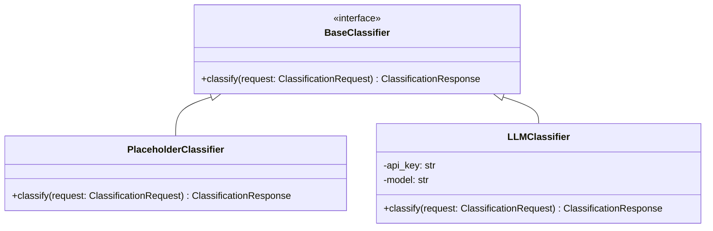

# StudyTube Backend API

A clean, modular Python and FastAPI backend designed for **StudyTube** — the distraction-reducing Chrome extension for YouTube.

This service receives video metadata from the Chrome extension and provides an extensible foundation for video classification (distraction vs. educational) and smart focus mode recommendations (`grayscale` vs. `color`).

---

## Architecture & Project Structure

```
backend/
├── .env.example              # Environment variables template
├── requirements.txt          # Production and testing dependencies
├── README.md                 # Backend documentation
├── app/
│   ├── __init__.py
│   ├── main.py               # FastAPI application setup, CORS, and error handlers
│   ├── config.py             # Pydantic Settings and environment configuration
│   ├── api/
│   │   ├── __init__.py
│   │   └── v1/
│   │       ├── __init__.py
│   │       ├── router.py     # API v1 router aggregator
│   │       └── endpoints/
│   │           ├── __init__.py
│   │           ├── classify.py # POST /api/v1/classify
│   │           └── health.py   # GET /api/v1/health
│   ├── schemas/
│   │   ├── __init__.py
│   │   ├── video.py          # Request and Response Pydantic models
│   │   └── health.py         # Health check response model
│   └── services/
│       ├── __init__.py
│       └── classifier.py     # BaseClassifier interface & PlaceholderClassifier
└── tests/
    ├── __init__.py
    ├── test_health.py        # Health and OpenAPI tests
    └── test_classify.py      # Classification, validation, and CORS tests
```

---

## Quickstart

### 1. Prerequisites
- **Python 3.10+**
- **pip**

### 2. Create and Activate Virtual Environment

```bash
# Windows (PowerShell)
cd backend
python -m venv .venv
.\.venv\Scripts\Activate.ps1

# Linux / macOS
cd backend
python3 -m venv .venv
source .venv/bin/activate
```

### 3. Install Dependencies

```bash
pip install -r requirements.txt
```

### 4. Configure Environment Variables

Copy the `.env.example` file to `.env`:

```bash
# Windows (PowerShell)
Copy-Item .env.example .env

# Linux / macOS
cp .env.example .env
```

Review and adjust settings in `.env` as needed.

### 5. Start the Development Server

```bash
# From the backend directory:
uvicorn app.main:app --reload --host 127.0.0.1 --port 8000
```

The API will be available at: `http://127.0.0.1:8000`

---

## API Endpoints

### 1. Health Check

- **Route:** `GET /health` (also mirrored at `GET /api/v1/health`)
- **Description:** Verifies that the server is operational.
- **Example Response:**
  ```json
  {
    "status": "healthy",
    "version": "0.1.0",
    "timestamp": "2026-10-21T16:39:14.123456Z",
    "environment": "development"
  }
  ```

### 2. Classify Video

- **Route:** `POST /api/v1/classify`
- **Description:** Accepts YouTube video metadata, validates fields, and returns a classification response.
- **Request Headers:** `Content-Type: application/json`

#### Request Body
| Field | Type | Required | Description | Constraints |
|---|---|:---:|---|---|
| `video_id` | string | **Yes** | YouTube video ID | 1–64 characters, non-blank |
| `title` | string | **Yes** | YouTube video title | 1–500 characters, non-blank |
| `channel_name` | string | No | Channel / creator name | Max 255 characters |
| `url` | string | No | Video URL | Max 2048 characters |

**Example Request:**
```json
{
  "video_id": "example123",
  "title": "Introduction to Machine Learning",
  "channel_name": "Example Learning",
  "url": "https://www.youtube.com/watch?v=example123"
}
```

**Example Response (200 OK):**
```json
{
  "video_id": "example123",
  "category": "unknown",
  "confidence": 0.0,
  "suggested_mode": "grayscale",
  "classifier": "placeholder"
}
```

#### Error Handling (422 Unprocessable Entity)
If required fields are missing or whitespace-only, the API returns a structured error:
```json
{
  "detail": "Request validation failed",
  "errors": [
    {
      "field": "title",
      "message": "Value error, title cannot be empty or blank whitespace",
      "type": "value_error"
    }
  ]
}
```

### 3. Interactive Documentation
- **Swagger UI:** `http://127.0.0.1:8000/docs`
- **ReDoc:** `http://127.0.0.1:8000/redoc`
- **OpenAPI JSON:** `http://127.0.0.1:8000/openapi.json`

---

## Example Usage with cURL & PowerShell

### Health Check:
```bash
# cURL
curl -X GET "http://127.0.0.1:8000/health"

# PowerShell
Invoke-RestMethod -Uri "http://127.0.0.1:8000/health" -Method Get
```

### Classify Video:
```bash
# cURL
curl -X POST "http://127.0.0.1:8000/api/v1/classify" \
  -H "Content-Type: application/json" \
  -d '{
    "video_id": "example123",
    "title": "Introduction to Machine Learning",
    "channel_name": "Example Learning",
    "url": "https://www.youtube.com/watch?v=example123"
  }'

# PowerShell
$body = @{
    video_id = "example123"
    title = "Introduction to Machine Learning"
    channel_name = "Example Learning"
    url = "https://www.youtube.com/watch?v=example123"
} | ConvertTo-Json

Invoke-RestMethod -Uri "http://127.0.0.1:8000/api/v1/classify" -Method Post -Body $body -ContentType "application/json"
```

---

## Chrome Extension Integration & CORS

When the Chrome extension sends a request from YouTube, the browser sets the `Origin` header depending on the execution context:
1. **Background Service Worker (`chrome.runtime`):** May send `chrome-extension://<EXTENSION_ID>`.
2. **Content Script (`fetch` from `youtube.com`):** May send `https://www.youtube.com` or extension origin.

### CORS Setup for Unpacked Extension
1. Open `chrome://extensions` in Google Chrome and enable **Developer mode**.
2. Locate **StudyTube — Focus Mode** and copy the 32-character **ID** (e.g., `nkbihfbeogaeaoehlefnkodbefgpgknn`).
3. Add this origin to `backend/.env`:
   ```env
   CORS_ORIGINS="http://localhost:3000,http://127.0.0.1:8000,https://www.youtube.com,chrome-extension://nkbihfbeogaeaoehlefnkodbefgpgknn"
   ```
4. **Development Regex:** During local unpacked development, `CORS_ALLOW_EXTENSION_REGEX=true` is enabled by default in `.env.example`. This automatically permits any local `chrome-extension://[id]` without wildcarding `*` for arbitrary websites.

### Asynchronous, Non-Blocking Extension Call Pattern
In the Chrome extension content script or background worker, always call the backend asynchronously so YouTube navigation and playback controls are never stalled:

```javascript
async function classifyCurrentVideo(videoId, title, channelName, url) {
  try {
    const response = await fetch('http://127.0.0.1:8000/api/v1/classify', {
      method: 'POST',
      headers: {
        'Content-Type': 'application/json',
      },
      body: JSON.stringify({
        video_id: videoId,
        title: title,
        channel_name: channelName,
        url: url,
      }),
    });

    if (!response.ok) {
      console.warn('[StudyTube] Classification failed with status', response.status);
      return null;
    }

    const data = await response.json();
    console.log('[StudyTube] Classification result:', data);
    return data;
  } catch (error) {
    // Fail gracefully so extension video grayscale rules remain intact
    console.error('[StudyTube] Backend API unreachable:', error);
    return null;
  }
}
```

---

## Future LLM Integration Guide

The service is built with the **Dependency Inversion Principle** via `app/services/classifier.py`:



### Steps to Connect an LLM Service Later:
1. Define provider credentials in `backend/.env` (e.g. `LLM_PROVIDER="gemini"`, `LLM_API_KEY="AIza..."`).
2. In `app/services/classifier.py`, create a new class implementing `BaseClassifier`:
   ```python
   class GeminiClassifier(BaseClassifier):
       def __init__(self, api_key: str, model: str):
           self.api_key = api_key
           self.model = model

       async def classify(self, request: ClassificationRequest) -> ClassificationResponse:
           # Call LLM provider API here...
           return ClassificationResponse(
               video_id=request.video_id,
               category="educational",
               confidence=0.92,
               suggested_mode="color",
               classifier=f"gemini-{self.model}",
           )
   ```
3. Update `get_classifier()` in `app/services/classifier.py`:
   ```python
   def get_classifier() -> BaseClassifier:
       if settings.LLM_PROVIDER == "gemini":
           return GeminiClassifier(api_key=settings.LLM_API_KEY, model=settings.LLM_MODEL)
       return PlaceholderClassifier()
   ```
4. **Security Principle:** Never pass LLM API keys to the Chrome extension. All prompt engineering, rate limiting, and API credentials remain strictly confined to the backend server.

---

## Testing

The backend includes a comprehensive test suite covering:
- Health and OpenAPI endpoints
- Classification payload validation (full payloads, optional fields)
- Input validation boundaries (blank titles, length limits)
- Malformed request recovery
- CORS preflight and origin verification
- Classifier service dependency swapping

Run the tests using pytest:

```bash
# From backend directory
pytest -v

# Or from workspace root
.\backend\.venv\Scripts\pytest.exe backend\tests -v
```
